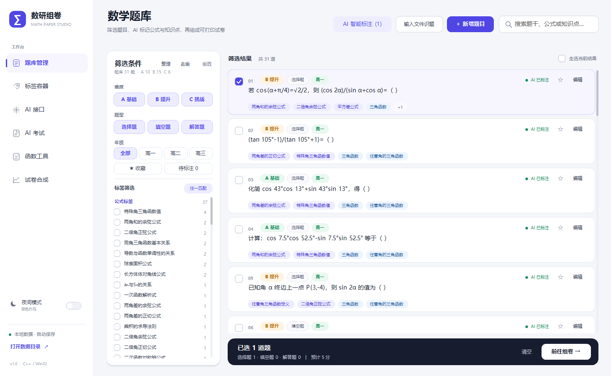
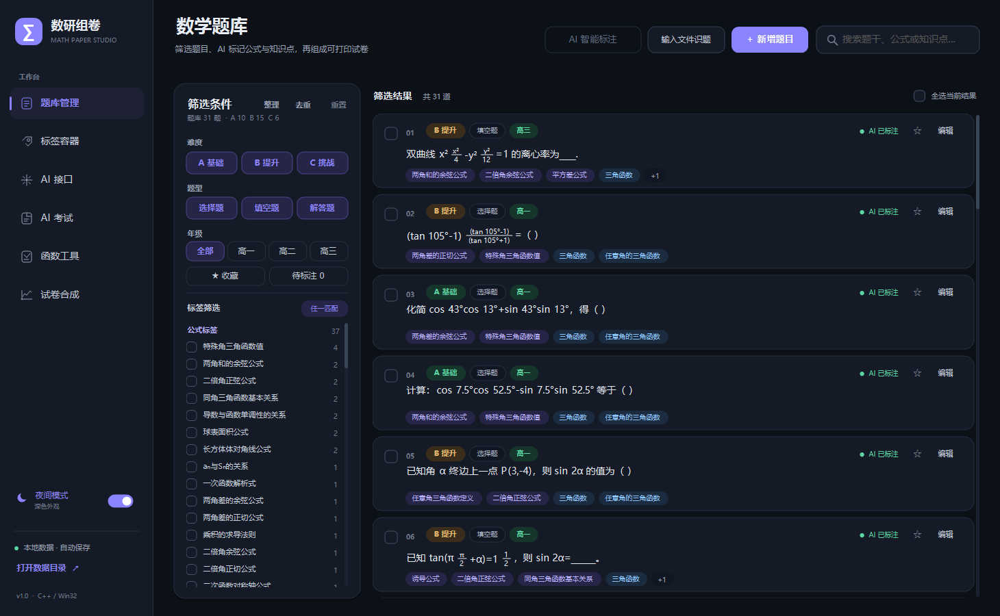
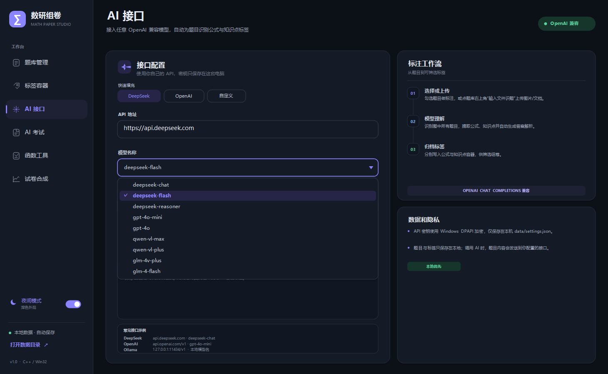
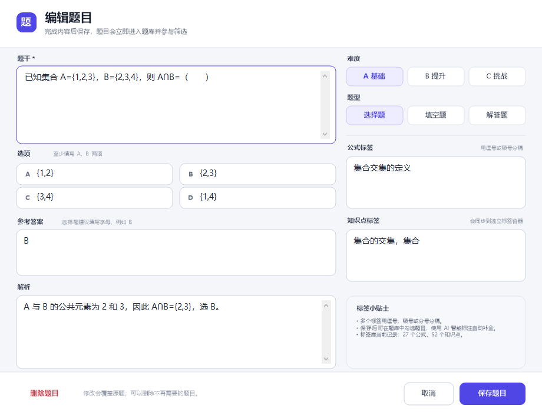
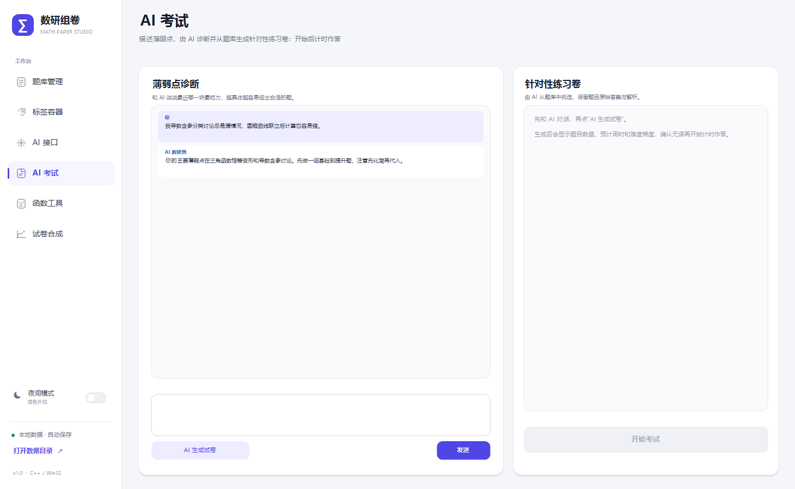
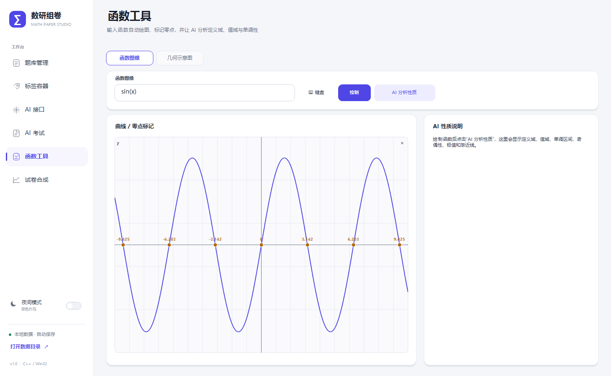
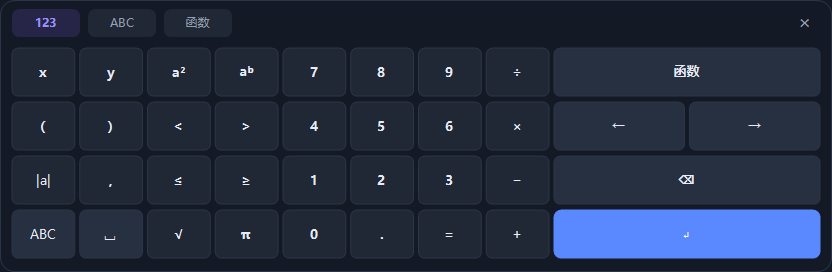
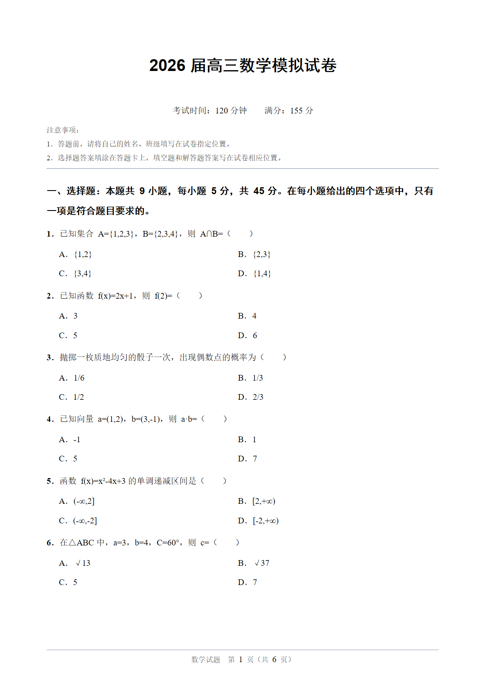
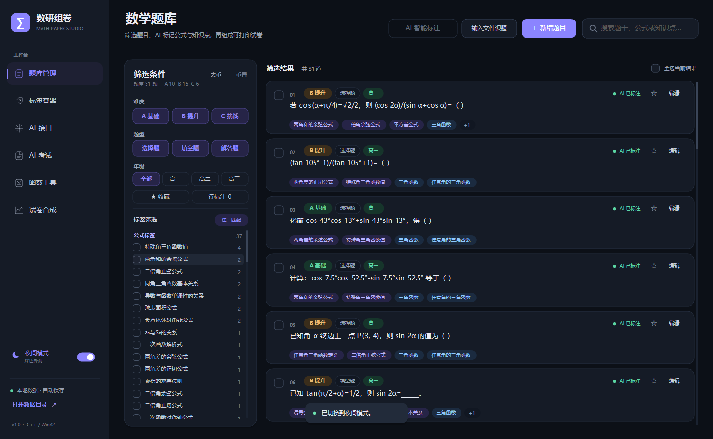
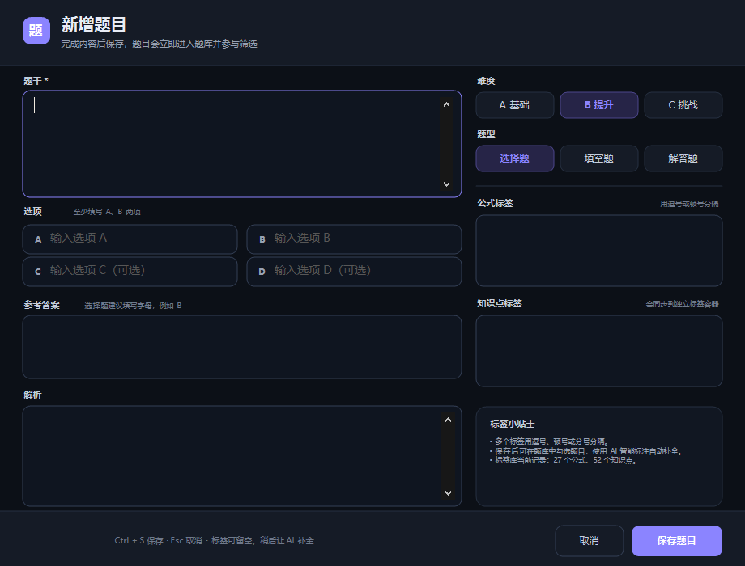

# 数研组卷 · MathPaperStudio

一个使用 **C++17 + Win32 + GDI+** 开发的本地桌面数学组卷程序，支持清晰渲染和日间/夜间双主题。它把题库、AI 标签库和试卷导出串成一条完整流程：

**输入图片/Word/文本 → AI 识别题目并生成答案解析/标签 → 按年级、难度与标签筛选 → 勾选组卷 / AI 考试 → 导出 A4 Word 试卷**



> **v1.1 新增**：年级分类、题目收藏、智能整理/去重、AI 考试、函数图像、几何示意图、Desmos 风格数学键盘，以及 DOCX/TXT 文件识题。
>
> **v1.2.1 新增**：桌面端题目配图；4 道图片选项题补入 A–D 选项图；题库搜索支持题目 ID；列表增加“待补全”标记，并生成题目完整性审计。`data/questions.json` 已内置 31 道题的配图。

## 快速开始

1. 双击 `MathPaperStudio.exe`，或双击 `启动数研组卷.bat`。
2. 首次启动会内置 24 道示例题，覆盖 A/B/C 三个难度，包含选择题、填空题和解答题。
3. 在题库右上角点“**输入文件识题**”，可一次选择 1–40 个图片 / DOCX / TXT / MD 文件。AI 会提取文件中的**所有题目**，自动生成答案、解析、难度、年级和公式/知识点标签，确认后批量加入题库。若 DOCX 旁边有同名“_页面图片”文件夹，程序会自动改用它做视觉识题。
4. 侧边栏底部的“**夜间模式**”开关可随时切换深色外观，选择会自动保存。
5. 需要针对性练习时，打开“**AI 考试**”描述薄弱点，让 AI 组卷后开始计时作答；需要画图时打开“**函数工具**”。
6. 在“试卷合成”中设置标题和输出选项，导出 `.docx`，用 Word / WPS 打开即可打印。

运行环境：Windows 10 / 11 x64。程序无第三方 DLL 依赖，直接运行；首次启动会在程序目录生成 `data` 文件夹。

## 功能

### 1. 数学题库

- 三个难度：**A 基础 / B 提升 / C 挑战**。
- 三种题型：选择题、填空题、解答题。
- 新增 **高一 / 高二 / 高三** 三个年级与“全部”筛选；AI 标注和文件识题会尝试自动归级，旧题按知识点推断。
- 新增 **收藏（星标）**：列表和编辑器中可点星号收藏，并可用“★ 收藏”筛选。
- 支持新增、编辑、删除题目；选择题支持 A–D 四个选项。
- 支持题目配图：编辑器右侧可**选择图片 / 更换图片 / 清除图片**，列表标出“配图”或“缺图”，导出 Word 时自动嵌入配图。
- 题库搜索支持按题目 ID 查找；列表会用红色“待补全”标记选项/答案异常的题目，审计结果见 [docs/question-audit.md](docs/question-audit.md)。
- 题目、答案、解析、年级、收藏、公式标签、知识点标签和配图全部保存在本地。
- 题库和 AI 考试题干会把 `x²/4`、`(cos 2α)/(sin α+cos α)`、`1/2` 这类简单分式排版成上下分式，而不是直接显示斜杠。
- 选择题选项按两栏排版导出；解答题可预留书写空间。
- 题目列表左上方提供“**整理**”和“**去重**”：
  - **整理**：规范化数学符号，把“7.5°cos”这类隐含乘法补成“7.5°·cos”，清理多余的 LaTeX/空格；
  - **去重**：忽略空格、标点、全角/半角和乘号差异（如 `cos7.5°cos52.5°` 与 `cos7.5°*cos52.5°`），把规范形式相同的题视为重复，保留信息最完整/已收藏的一道。

### 2. AI 接口、文件识题与标签容器

- 兼容 **OpenAI Chat Completions** 协议，可接入：
  - DeepSeek
  - OpenAI
  - Ollama、vLLM、LM Studio 等本地/自托管服务
  - 其他 OpenAI 兼容服务
- 配置项：API 地址、模型名称、API 密钥。
- **模型名称改为下拉选择**，不再手填；内置 DeepSeek / OpenAI / Qwen / GLM 常用模型，包括 `deepseek-flash`、`deepseek-chat`、`deepseek-reasoner`、`gpt-4o-mini`、`gpt-4o`、`qwen-vl-max`、`qwen-vl-plus`、`glm-4v-plus`、`glm-4-flash`。
- 选择模型时会自动切换到对应的默认 API 地址；DeepSeek / OpenAI 快速填充按钮仍保留。
- API 密钥使用 **Windows DPAPI** 加密，只在当前 Windows 用户下可解密，不会以明文写入磁盘。
- **文件识题（支持多文件、多题）**：
  - 在题库右上角点击“输入文件识题”，一次可以选择 1–40 个文件/页面；
  - 支持图片：PNG / JPG / JPEG / BMP / GIF；
  - 支持文档：DOCX / TXT / MD。DOCX 在本地解压并读取 WordprocessingML 文本，TXT/MD 读取 UTF-8 或 UTF-16LE 文本；
  - 如果 DOCX 的公式是 **MathType/WMF 嵌入图片**（文字层只有题干碎片），程序会检测并提示，而不会把残缺题目导入；请用 Word/WPS 把页面导出/截图成 PNG 后按图片识题；
  - 如果 DOCX 同目录存在 `<文档名>_页面图片` 文件夹，选择该 DOCX 时程序会自动改用里面的 PNG 页面做视觉识题（最多 40 页）；
  - 旧版 `.doc` 和 PDF 暂不支持直接解析，请先用 Word/WPS 另存为 `.docx`；
  - 图片会按需缩放、纠正 EXIF 方向并压缩后，以 OpenAI 视觉消息格式发送；文档则把提取出的文本发送给文本模型；
  - 一张图片/一个文档中包含多道题时，AI 会按顺序全部提取；
  - AI 会为**每一道题独立求解**，自动生成答案、解析、年级、难度和标签，即使原文件没有答案；
  - 同一道题的多个小问（如 (1)(2)）会合并为一道题；
  - 识别结果先显示确认框（题目数量、缺失答案/解析提醒），确认后批量加入题库顶部；
  - 图片需要**支持图片输入的视觉模型**（如 `gpt-4o-mini`、`qwen-vl-*`、`glm-4v`）；DOCX/TXT 只需普通文本模型；
  - 如果模型返回 LaTeX，程序会自动转换为可读的 Unicode 数学文本，并补齐 `7.5°cos` 这类隐含乘法。
- 图片/文档只用于本次 AI 请求，不会保存到本地题库。







- AI 标签标注会读取题干与选项，输出严格的 JSON：
  ```json
  {"grade":"高一","formulas":["余弦定理"],"concepts":["解三角形","三角函数"]}
  ```
- 标签自动写入独立分类：
  - **公式标签**（公式、定理、运算名称）
  - **知识点标签**（知识概念、方法、题型）
- 年级写入题目的 `grade` 字段；旧题没有字段时按知识点推断，并可在编辑器中修正。
- 已有标签会作为提示词上下文发送给模型，便于复用同一套标签体系。
- AI 标注是逐题请求的，界面会显示进度；失败时保留原标签并给出错误原因。

#### 常用配置示例

| 服务 | API 地址 | 模型名称 |
| --- | --- | --- |
| DeepSeek | `https://api.deepseek.com` | `deepseek-chat` |
| OpenAI | `https://api.openai.com/v1` | `gpt-4o-mini` |
| Ollama | `http://127.0.0.1:11434/v1` | 例如 `qwen2.5:7b` |

> API 地址和模型为必选项。使用本地服务时，API 密钥可以留空。
> 点击“测试连接”会发送一条最小请求，可能产生极少量的接口费用。
> 图片识题使用的是同一个模型配置，因此需要从列表中选择支持图片输入的视觉模型；
> 如果只想用纯文本模型做标签或 DOCX/TXT 识题，则不要导入图片。

### 3. 筛选与自主选择题

- 关键词搜索题干、答案、解析与标签。
- 难度多选、题型多选。
- 年级单栏：**全部 / 高一 / 高二 / 高三**；全部是默认选项。
- **★ 收藏**筛选可只看星标题。
- 标签多选；支持：
  - **任一匹配**：选中“三角函数”或“集合”中任一标签的题；
  - **全部匹配**：题目必须同时拥有选中的所有标签。
- “只看待标注”可筛出还没有标签的题目。
- 点击标签容器中的任意标签，会回到题库并自动应用该标签筛选。
- 不限制选择数量；选中的题会进入底部组卷篮，并实时统计各题型与预计总分。

### 4. AI 考试

- 在“AI 考试”页先和 AI 对话，描述自己的薄弱点（支持多轮对话）。
- AI 先给出诊断和追问；点击“AI 生成试卷”后，AI 会读取题库目录，选择 5–8 道针对性的题目，并生成标题和考试时长。
- 生成后点击“开始考试”才启动倒计时；题型支持：
  - 选择题：点击 A/B/C/D 选项；
  - 填空题：在编辑框中输入答案，可调用数学键盘；
  - 解答题：作答后交卷，参考答案用于自评。
- 交卷后自动判分选择题和填空题，显示总分、正确题数和逐题结果；解答题标记为“自评”。
- AI 选择失败时会按薄弱点关键词和标签在本地回退组卷，不会让题库为空。



> 说明：AI 考试目前是即时练习，不保存历史考试记录；AI 选题/判分仅作练习参考。

### 5. 函数工具与几何示意

- **函数图像**：
  - 输入 `sin(x)`、`x^2-4`、`2sin(x)+1` 等单变量表达式；
  - 支持 `+ - * / ^`、括号、隐式乘法、`sin/cos/tan/asin/acos/atan/sqrt/abs/log/ln/exp/floor/ceil`、`pi/π/e`；
  - 自动绘制曲线、坐标轴和网格，标记在 `[-10,10]` 范围内的零点；
  - 点击“AI 分析性质”，AI 会结合图像说明定义域、值域、单调区间、奇偶性、极值和渐近线。
- **几何示意图**：
  - 输入几何题描述，或先选中一道题（会自动把题干带进描述）；
  - AI 返回归一化的点、线段和圆数据，程序本地绘制平面/立体示意图；
  - 适合课堂板书和草稿预览，不依赖外部图片生成服务。



> 几何图是**示意草图**，不保证与题目比例、隐藏线或标准图形完全一致；当前不会嵌入 Word 试卷。

### 6. Desmos 风格数学键盘

- 编辑器、函数工具和 AI 考试的输入框旁都有“⌨ 数学键盘”。
- 三个页签：
  - **123**：数字、四则运算、括号、比较符号、根号、π、上下标、功能键、退格、回车；
  - **ABC**：数学常用字母、θ、Shift、括号/大括号、百分号等；
  - **函数**：sin、cos、tan、arcsin、ln、log、√、∞、∫ 等。
- 键盘是独立的非激活弹窗，点击按键会把内容插入当前输入框，输入焦点和光标位置保持不丢。



### 7. 试卷合成与导出

- 在“试卷合成”设置试卷标题、考试时间、注意事项。
- 可勾选：
  - 生成参考答案；
  - 附详细解析；
  - 解答题预留书写空间。
- Word 文档版式：
  - A4 纵向，页边距 2.0 / 2.2 cm；
  - 标题黑体、正文宋体、页脚自动页码；
  - 按“选择题 → 填空题 → 解答题”分节；
  - 题号连续，组内按 A → C 难度排序；
  - 选择题选项两栏排列，避免原生表格边框；
  - 参考答案与解析自动另起一页。
- 默认分值：选择题 5 分、填空题 5 分、解答题 12 分；满分按已选题目自动计算。

示例输出：[docs/示例试卷.docx](docs/示例试卷.docx)



### 8. 界面清晰度与夜间模式

- 界面使用 **ClearType 文字渲染 + 原生像素级双缓冲拷贝**，不再经过位图缩放或二次采样，文字和 1 像素边框更锐利。
- 支持 **日间 / 夜间双主题**：侧边栏底部开关即时切换，自定义绘制区域、原生输入框、滚动条和窗口标题栏会同步换色。
- 夜间模式偏好保存在 `data/settings.json` 的 `dark_mode` 字段，重启后保持上次选择。
- 试卷版式预览中的“纸张”始终保持白色，便于在夜间模式下准确预览打印效果。





## 使用流程建议

1. 在“AI 接口”填写并保存 API 配置，点击“测试连接”确认可用。
2. 在“题库管理”点击“输入文件识题”，选择图片或 DOCX/TXT 文档；AI 会提取全部题目并生成答案、解析、年级和标签，确认后批量导入。
3. 已有题目可以在列表中勾选，点击“AI 智能标注”补全/更新年级、公式和知识点标签；用“整理/去重”维护题库。
4. 用星号收藏重点题，或按高一/高二/高三、难度和标签筛选。
5. 打开“标签容器”检查归档结果；以后可按标签反向筛题。
6. 在“AI 考试”里对话诊断并生成练习卷，开始计时作答；在“函数工具”里画函数/生成几何示意图。
7. 勾选要进入试卷的题目，点击底部“前往组卷”；设置标题、时间和注意事项，导出 `.docx`。

## 本地数据

所有数据位于程序同目录下的 `data`：

| 文件 | 内容 |
| --- | --- |
| `data/questions.json` | 题库、难度、年级、收藏、题型、选项、答案、解析、标签 |
| `data/tags.json` | 公式标签容器与知识点标签容器 |
| `data/settings.json` | API 地址、模型、夜间模式；密钥为 Windows DPAPI 密文 |

- 备份或迁移时，直接复制整个 `data` 目录。
- 如果题库文件损坏，程序会自动备份原文件并载入示例题库。
- 删除 `data` 文件夹后重启，会重新生成示例题库和默认设置。

## 目录结构

```
MathPaperStudio/
├─ MathPaperStudio.exe         编译好的 Windows 程序
├─ 启动数研组卷.bat
├─ data/                       题库、标签库、AI 配置
├─ docs/                       截图、示例试卷、移动端迁移评估
├─ src/
│  ├─ main.cpp                 程序入口、COM/GDI+/DPI 初始化
│  ├─ app.h / app.cpp          主窗口、页面与业务调度
│  ├─ ui.h / ui.cpp            自绘 UI 工具层与主题
│  ├─ editor.h / editor.cpp    题目编辑弹窗
│  ├─ ai.h / ai.cpp            AI 标签、图片/文档识题与 JSON 解析
│  ├─ image_data.h / .cpp      图片解码、EXIF、压缩与 Base64
│  ├─ text_file.h / .cpp       DOCX/TXT/MD 文本提取（含 DEFLATE 解压）
│  ├─ math_text.h / .cpp       LaTeX 到可读 Unicode 数学文本
│  ├─ math_draw.h / .cpp       分式/数学符号的本地排版绘制
│  ├─ math_expr.h / .cpp       函数表达式解析、求值与零点搜索
│  ├─ dedup.h / .cpp           数学规范化、隐含乘号和题目去重
│  ├─ keyboard.h / .cpp        Desmos 风格数学键盘弹窗
│  ├─ model.h / model.cpp      题目、标签、年级、收藏、筛选模型
│  ├─ seed.h / seed.cpp        内置示例题库数据
│  ├─ store.h / store.cpp      JSON 持久化、DPAPI、损坏恢复
│  ├─ json.h / json.cpp        轻量 JSON 解析器/序列化器
│  ├─ docx.h / docx.cpp        OOXML 试卷生成与 ZIP 封装
│  ├─ util.h / util.cpp        UTF/路径/时间/文件/Base64 工具
│  └─ selftest.cpp             核心功能自测
├─ res/                        图标、资源与 DPI 清单
├─ CMakeLists.txt
├─ build.ps1
└─ build/
   ├─ selftest.exe             核心自测程序
   └─ ...                      CMake 中间文件
```

## 代码结构与模块职责

这个项目是**单进程的 Win32 桌面程序**，没有 Qt、Electron、浏览器或第三方 UI 框架。界面使用“立即模式绘制”：每帧根据当前状态重新画整个界面，并把可点击区域记录到 `hits_` 中；只有需要输入文字时才创建原生 `EDIT` 控件。

### 各模块的作用

| 模块 | 主要职责 | 关键内容 |
| --- | --- | --- |
| `src/main.cpp` | 程序入口 | `wWinMain`；设置 DPI awareness；初始化 COM 和 GDI+；创建 `App` 并进入消息循环。 |
| `src/app.h` / `app.cpp` | 主窗口与应用调度 | 六个页面（题库、标签、AI、AI 考试、函数工具、试卷）；所有 `WM_*` 消息；鼠标命中/hover/滚动；年级/收藏/标签筛选；AI 标注、文件识题、AI 对话组卷、计时答题；函数/几何画板；主题切换；导出入口。 |
| `src/ui.h` / `ui.cpp` | 自绘 UI 工具层 | `Rect`、`Theme`、`Canvas`；字体缓存、圆角矩形、线段、裁剪、文本测量/省略号、复选框；ClearType 文字渲染；DWM 原生标题栏明暗适配。 |
| `src/editor.h` / `editor.cpp` | 题目编辑器 | 独立模态窗口；题干/选项/答案/解析/标签的原生输入框；选择题/填空题/解答题切换；A/B/C 难度；高一/高二/高三；收藏星标；数学键盘入口；保存校验；暗色主题。 |
| `src/ai.h` / `ai.cpp` | AI 能力 | OpenAI Chat Completions 兼容请求；文本标签提示词；视觉请求（`image_url` data URL）；多题 `questions[]` 解析；文档识题；通用 `AskAiChat`；答案/解析生成约束；错误与超时处理。 |
| `src/image_data.h` / `image_data.cpp` | 图片预处理 | 使用 GDI+ 读取 PNG/JPEG/BMP/GIF；按 EXIF 方向纠正；限制最长边并缩放；白底合成；JPEG 编码；Base64 data URL。 |
| `src/text_file.h` / `text_file.cpp` | 文件读取 | 解析 DOCX 的 ZIP 中央目录、DEFLATE 解压和 WordprocessingML；读取 TXT/MD 的 UTF-8/UTF-16LE；对 DOC/PDF 给出明确错误。 |
| `src/math_text.h` / `math_text.cpp` | 数学文本清洗 | 去除 `$…$`、`\(…\)`；递归解析 `\frac`、`\sqrt`、希腊字母、常用符号、上下标；把 LaTeX 转换成人类可读的 Unicode 数学文本；统一 `÷`/`／` 为 `/`。 |
| `src/math_draw.h` / `math_draw.cpp` | 数学排版 | 识别简单 `a/b` 分式，在题库和 AI 考试题干中绘制上下结构和分数线；空间不足时回退为普通文本。 |
| `src/math_expr.h` / `math_expr.cpp` | 函数引擎 | 递归下降解析 `+ - * / ^`、隐式乘法、三角函数、对数、根号等；`Evaluate` 返回 NaN 处理定义域；`FindRoots` 扫描并二分求零点。 |
| `src/dedup.h` / `dedup.cpp` | 智能整理/去重 | 规范化空白、标点、全角字符、乘号；忽略 `cos7.5°cos52.5°` 与 `cos7.5°*cos52.5°` 的差异；`InsertImplicitMultiplication` 补 `·`。 |
| `src/keyboard.h` / `keyboard.cpp` | 数学键盘 | 独立 `WS_EX_NOACTIVATE` 弹窗；123/ABC/函数三页；通过 `EM_REPLACESEL` 插入当前原生输入框；退格/方向/回车。 |
| `src/model.h` / `model.cpp` | 核心数据模型 | `Question`、`TagLibrary`、`Settings`、`QuestionFilter`；题型/难度/年级枚举；收藏；标签合并、使用次数统计；年级推断与题目筛选。 |
| `src/seed.h` / `seed.cpp` | 内置示例数据 | 24 道示例题、27 个公式标签、52 个知识点标签；首次启动或数据损坏时用于初始化。 |
| `src/store.h` / `store.cpp` | 本地数据层 | 加载/保存 `questions.json`、`tags.json`、`settings.json`；字段校验与默认值；原子写入；API Key 的 Windows DPAPI 加密；文件损坏备份与恢复。 |
| `src/json.h` / `json.cpp` | JSON 基础设施 | 自行实现的 JSON AST；解析、转义、Unicode `\uXXXX`、数组/对象访问、紧凑/缩进输出。 |
| `src/docx.h` / `docx.cpp` | Word 试卷生成 | 直接写 OOXML；A4 页面/页边距/字体/页脚；按选择题→填空题→解答题分节；A→C 排序；选项制表位两栏；答案页分页；写入自定义 Store-only ZIP。 |
| `src/util.h` / `util.cpp` | 通用工具 | UTF-8/UTF-16 转换、Trim、标签/行拆分、文件原子写入、可执行目录/桌面/图片目录、时间与 ID、Base64、整数夹取。 |
| `src/selftest.cpp` | 自测程序 | 验证 JSON、题库/标签/筛选、DOCX、图片编码、Store/DPAPI、暗色偏好、函数解析/零点、去重规范化、TXT/DOCX 文本提取等核心路径，不启动图形界面。 |
| `CMakeLists.txt` / `build.ps1` | 构建系统 | C++17、MinGW-w64、静态链接；同时构建 `MathPaperStudio.exe` 和 `build\selftest.exe`；资源文件包含图标和 DPI manifest。 |
| `res/app.rc`、`app.manifest`、`app.ico` | Windows 资源 | 程序图标、版本/清单资源、系统 DPI 感知、Common Controls 6.0、长路径支持。 |
| `data/` | 运行数据 | 题库、两个标签容器、API 与主题配置；可直接备份或迁移。 |
| `docs/` | 交付文档 | 亮/暗主题截图、AI 考试/函数工具/数学键盘截图、示例试卷、`mobile-migration.md`。 |

### 一次操作在代码中的流转

1. **启动**
   `main.cpp` 初始化 COM/GDI+ → `App::Create` → `Store::Initialize` 读取 `data/`，数据为空则调用 `seed.cpp` 生成示例题库 → 初始化字体、控件和主题 → 进入 `Run()` 的消息循环。

2. **界面绘制**
   `App::OnPaint` 创建不透明 32 位缓冲区 → `ui::Canvas` 使用 ClearType 绘制当前页面 → 将缓冲区按 1:1 像素拷贝到窗口。鼠标移动时重建 `hits_` 的 hover 状态，点击时由 `Activate()` 分发动作。

3. **筛选与组卷**
   用户操作修改 `QuestionFilter` 和 `selectedIds_` → `App::RebuildFiltered()` 重新计算 `visibleIds_` → 题库列表重绘；底部组卷篮实时统计题型和预计分数。

4. **AI 文本标注**
   选中题目 → `StartAiTagging()` 启动后台线程 → 逐题调用 `AnalyzeQuestionWithAi()` → 通过 `WM_APP` 消息回到主线程 → `Store::MergeQuestionTags` 合并标签 → 保存题库和标签库。

5. **文件识题**
   文件对话框（支持多选）→ 图片经 `EncodeImageForAi()` 压缩后调用 `AnalyzeQuestionImageWithAi()`；DOCX/TXT 经 `ExtractTextFile()` 后调用 `AnalyzeQuestionDocumentWithAi()` → 模型返回 `questions[]`，每项包含题干、选项、难度、年级、标签和独立求解的 `answer`/`analysis` → 主线程确认后批量插入题库顶部、合并标签并保存。

6. **题目编辑**
   `App::OpenQuestionEditor()` → `ShowQuestionEditor()` 创建独立模态窗口和原生 `EDIT` 控件 → 保存时把 `QuestionEditorResult` 返回主窗口 → `App::SaveQuestionFromEditor()` 规范化文本、补隐含乘法、更新/新增题目、保存数据。

7. **AI 考试**
   “AI 考试”页的对话 → `SendExamMessage()` 调用 `AskAiChat()` 诊断；`GenerateExamPaper()` 把题库目录发给模型，解析 `title/minutes/ids`；失败时按标签本地回退 → 点击“开始考试”启动 `kExamTimer` → 选择题直接记录选项，填空题/解答题写入 `examAnswerEdit_` → 交卷后 `SubmitExam()` 自动判分选择题和填空题。

8. **函数与几何工具**
   函数输入 → `mathexpr::Expression::Parse/Evaluate/FindRoots` → 本地绘制曲线和零点；“AI 分析性质”调用 `AskAiChat()`。几何描述 → AI 返回归一化的点/线段/圆 JSON → `PaintGeometryTools` 本地绘制。

9. **数学键盘**
   点击“⌨ 数学键盘” → `ShowMathKeyboard(owner, target, theme)` 创建非激活弹窗 → 按键通过 `EM_REPLACESEL` 插入目标 `EDIT`，不抢焦点。

10. **导出试卷**
    `selectedIds_` 生成有序题目列表 → 组装 `PaperOptions` → `GenerateExamDocx()` 写 OOXML 并打包为 `.docx` → 输出到桌面或用户选择的位置。

11. **主题切换**
    点击侧边栏“夜间模式” → `App::SetDarkMode()` 更新 `Settings.darkMode` → 应用 `col` / `edcol` 两套调色板 → 同步原生输入框画刷和 DWM 标题栏 → `Store::SaveSettings()` 持久化 → 下次启动恢复。

### 维护时从哪里改

- **改界面布局/新增按钮**：主要在 `app.cpp` 的 `Paint*`、`Compute*Rects`、`Activate` 和 `hits_` 逻辑中；新增文本框时同步修改 `LayoutEditControls`。
- **改 AI 提示词/返回结构**：改 `ai.cpp` 的 `BuildAiPrompt` / `BuildImagePrompt` 和对应解析函数；如果增加题目字段，还要同步 `model.*`、`store.*`、`editor.*`、`docx.*`。
- **改主题颜色**：主界面在 `app.cpp` 的 `namespace col`，编辑器在 `editor.cpp` 的 `namespace edcol`；两处都通过 `Apply(bool dark)` 切换。
- **改试卷版式**：集中在 `docx.cpp`；运行 `build\selftest.exe` 会生成 `docs/示例试卷.docx`，再用 Word/WPS 打开检查分页。
- **改数据结构/持久化**：从 `model.h` 开始，随后检查 `store.cpp`、`json.cpp` 的序列化兼容性。

## 从源码构建

需要：

- Windows 10/11 x64；
- CMake 3.20+；
- MinGW-w64 g++（验证版本为 GCC 16.2.0，POSIX 线程模型）。

在项目根目录运行：

```powershell
.\build.ps1
```

或手动：

```powershell
cmake -S . -B build -G "MinGW Makefiles" -DCMAKE_BUILD_TYPE=Release
cmake --build build -j 4
```

程序以静态方式链接 MinGW 运行时，只依赖 Windows 系统 DLL（GDI+、WinHTTP、DPAPI、Common Dialogs）。

## 自测

源码构建完成后运行：

```powershell
.\build\selftest.exe
```

自测覆盖：

- JSON 解析与转义；
- 示例题库、难度、题型、年级和标签；
- 标签/难度筛选；
- DOCX 试卷生成；
- 题库保存与重新加载；
- 夜间模式偏好保存与重新加载；
- DPAPI 密钥加密（明文不落盘、可正确解密）；
- 函数表达式解析、求值与零点搜索；
- 缺乘号/空白/标点差异下的题目去重；
- TXT 和 DOCX 文本提取（含 ZIP/DEFLATE）。

图片上传、多图多题识别、AI 自动生成答案/解析、批量导入、LaTeX 公式转可读文本，以及视觉消息请求也已用本地模拟视觉接口做过完整验证。

## 说明与边界

- “任意模型”在本程序中指 **OpenAI Chat Completions 兼容接口**。不兼容该协议的接口需要额外的网关适配。
- 图片识题使用 OpenAI 的 `image_url` 视觉消息格式；模型本身必须支持图片输入。DOCX/TXT 识题使用文本模型。
- `.doc` 和 PDF 没有内置解析器，请先用 Word/WPS 转成 `.docx`；当前不支持扫描版 PDF 的 OCR。
- DOCX 内的 MathType/WMF 公式是图片而不是文本；程序会检测公式对象数量并拒绝导入残缺题干。处理办法是把文档逐页导出为 PNG，再走图片识题。
- 分式排版目前覆盖简单 `a/b`、带括号的分子/分母和常见符号；不会把复杂矩阵、多行 cases 或 Word 公式对象自动转成排版。导出的 Word 试卷仍使用普通文本分数。
- 题目文本使用 Unicode 数学符号；常见 LaTeX 会被自动转换成可读文本，但导出的是普通文本，不会生成 Word 公式对象。特别复杂的分式、矩阵或多行 cases 可能显示为普通单行文本，可在编辑器中手工调整。
- AI 生成的答案、解析、年级和 AI 考试选题/判分都可能出错，请在使用前核对；程序不会自动验证数学正确性。
- AI 输出标签质量取决于所选模型；程序会校验 JSON 结构并做去重，但不会自动判断 OCR 转录是否完全正确。
- 一次文件识题最多选择 40 个文件/页面；如果题目和解析太多导致模型输出达到长度上限，程序会提示分批上传。
- 函数画板目前支持单变量显式函数，不支持隐函数、参数方程、不等式区域或复数图；零点只在 `[-10,10]` 内扫描。
- 几何示意图由 AI 返回的归一化点/线段/圆绘制，是示意草图，不保证与真实比例、隐藏线一致，当前不嵌入 DOCX。
- AI 考试不保存历史记录；解答题只提供参考答案，需自评。
- 导出的试卷用 Word/WPS 打开后即可打印；程序本身不直接调用打印机。

## 📱 手机版 v0.6.0（2026-10-20）

Android 版已完成首个可安装版本，源码在 [`mobile/`](mobile/)，发布包见：

- [GitHub Release v0.6.0-mobile](https://github.com/wnsnnnmwlls/math_warehouse/releases/tag/v0.6.0-mobile)
- [移动端说明](mobile/README.md)
- [题库配图说明](docs/question-figures.md)

当前手机版包含：235 题题库、搜索筛选、收藏、JSON 导入、AI 供应商配置、AI/自动/手动组卷、Word 试卷导出、已导出标记、最近做过篮子，以及 31 道几何/统计题的配图。

题库配图同时放入了仓库根目录的 `data/figures/` 和 `data/figure_map.json`，桌面版后续可复用；当前桌面版尚未读取这些配图。

## 手机端迁移评估

桌面版仍使用 C++/Win32；手机版已经用 Flutter 重写并发布。若要继续做 iOS 或评估后续移动端路线，可阅读：

- [移动端迁移技术评估](docs/mobile-migration.md)

评估覆盖了原生重写、Flutter/React Native 与 PWA 三条路线，建议 v1 使用 **Flutter + Dart 领域层 + 本地 SQLite**，先做“题库 + 标签 + 文件识题 + 试卷导出”四屏，AI 考试/函数画板/几何画板放后续版本；C++ 核心不建议直接 FFI 复用。文档中包含分阶段工作量、风险、Keychain/Keystore、相机识题、DOCX/PDF 导出和 BYOK 的具体建议。
