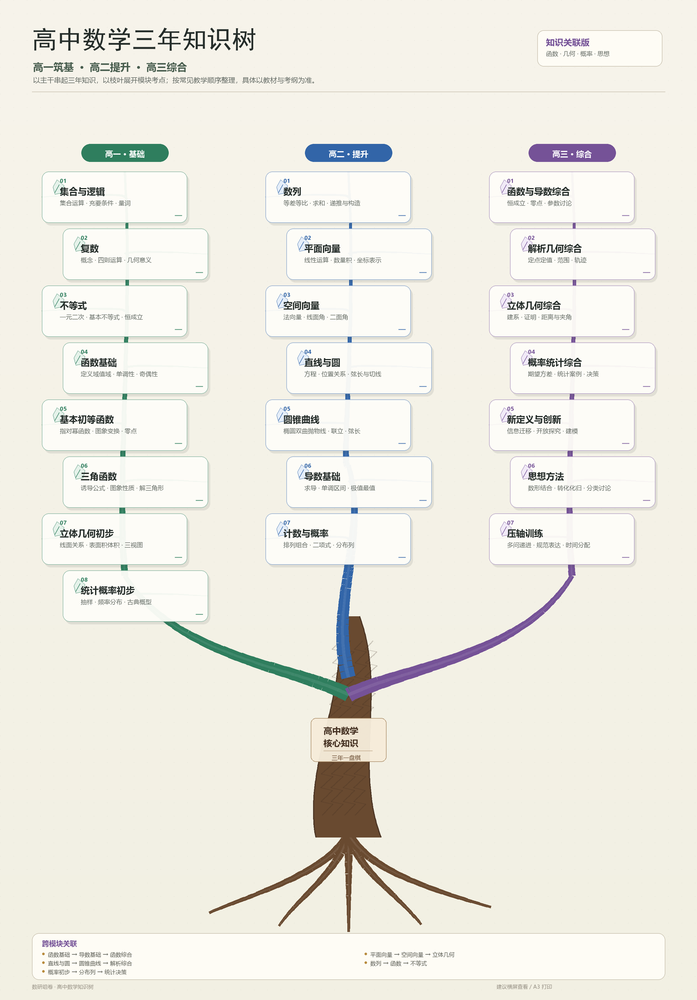

# 高中数学三年知识树

一张以“树干—三大主枝—模块叶片”为结构的高中数学知识总览图：

- **高一 · 基础**：集合与逻辑、复数、不等式、函数基础、基本初等函数、三角函数、立体几何初步、统计概率初步
- **高二 · 提升**：数列、平面向量、空间向量、直线与圆、圆锥曲线、导数基础、计数与概率
- **高三 · 综合**：函数与导数综合、解析几何综合、立体几何综合、概率统计综合、新定义与创新、思想方法、压轴训练
- 底部列出函数、向量、解析几何、数列、概率等跨模块关联

> 按常见教学顺序整理，具体章节顺序以所用教材和当地考纲为准。

原图：`docs/high-school-math-knowledge-tree.png`（2400 × 3440，适合 A3 打印或横屏查看）。
