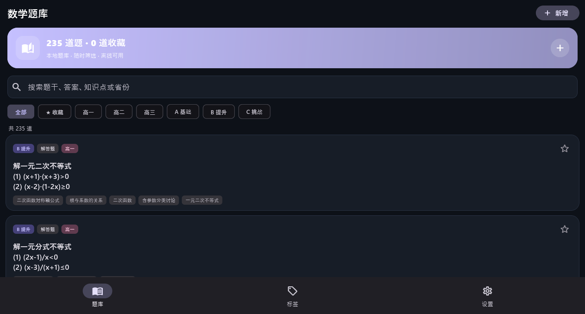
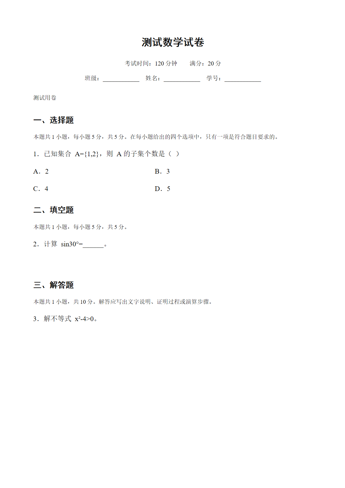
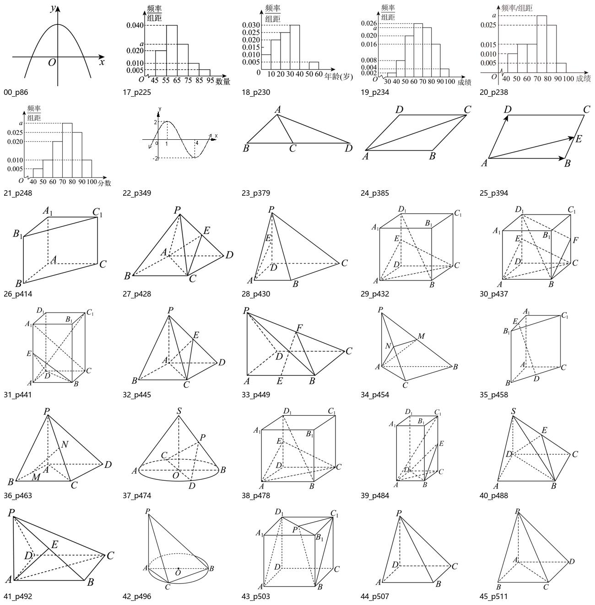

# 数研组卷 Mobile

Flutter 版 Android 题库 / 组卷 / Word 导出客户端，当前版本 **v0.8.0**。

桌面版仍为 C++17 + Win32 实现；手机版是同一套题库数据的 Dart/Flutter 重写，不是桌面程序的套壳。

## 功能

- 235 道高中数学题库，离线可用
- 搜索、年级/难度/省份/收藏/已导出/缺图筛选
- 新增、编辑、删除、收藏
- 题库 JSON 导入（按 ID 合并，重复跳过）
- AI 供应商配置（OpenAI 兼容接口，Key 存 Android Keystore）
- AI 组卷 / 题库自动组卷，默认 12 选择 + 4 填空 + 6 解答
- 手动逐题组卷
- 标准 A4 Word 试卷导出，可附答案解析
- 导出题自动标记“已导出”，进入“最近做过”篮子
- 31 道几何/统计题的配图已从 `数学精选题.docx` 提取并内置
- 题目配图支持相册补图/换图，导出 Word 时嵌入图片
- **函数图像**：支持 `y=x` / `f(x)=x` 写法、隐式乘法、三角函数等，支持中文描述让 AI 生成函数表达式
- **几何示意图**：AI 返回 x/y/z、隐藏棱和表面，本地按斜二测投影绘制半透明面和虚线；内置三棱锥示例

## 安装

从 GitHub Releases 下载：

`v1.4.1` → `MathPaperStudio-Mobile-v0.8.0-arm64-v1.4.1.apk`

绝大多数安卓手机使用 arm64 包；老 32 位设备使用 armeabi-v7a；不确定架构可用 universal 包。

首次安装允许“安装未知来源应用”。升级安装会保留题库、配图、收藏和最近做过记录。

## 构建

要求 Flutter 3.47+ / Dart 3.13+、JDK 17、Android SDK 36。

```bash
flutter pub get
flutter build apk --release --split-per-abi
```

产物：

```text
build/app/outputs/flutter-apk/app-arm64-v8a-release.apk
build/app/outputs/flutter-apk/app-armeabi-v7a-release.apk
build/app/outputs/flutter-apk/app-x86_64-release.apk
build/app/outputs/flutter-apk/app-release.apk
```

## 数据与配图

- `assets/questions.json`：235 道题
- `assets/figure_map.json`：题目 ID → 配图
- `assets/figures/`：31 道缺图题使用的 28 张图（30 张 DOCX 原图 + 1 张按题干重绘的圆锥示意图，部分题复用同图）
- 首次启动/升级会把配图写入应用私有目录的 `questions.json`，并写入 `figures_seeded` 标记；用户自己补的图不会被覆盖
- 根仓库 `data/figures/` 和 `data/figure_map.json` 是同一套配图的仓库级副本

## 已知限制

- 只导出 DOCX，暂不导出 PDF
- AI 识题/标注尚未接入，只有 AI 供应商配置和 AI 组卷
- 没有答题计时、成绩记录
- “最近做过”按导出时间记录，不是答题记录
- 当前 APK 使用 debug 签名，仅适合直接安装/内测；上架商店需要正式签名

## 截图






